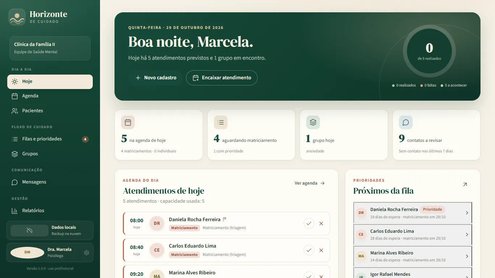

# Horizonte de Cuidado

Aplicativo para Windows/MSIX e Android criado para equipes de saúde mental organizarem encaminhamentos, fila de matriciamento, grupos, atendimentos individuais, contatos e o planejamento dos próximos 90 dias.

> **Ferramenta independente de apoio à organização do cuidado.** Não é prontuário eletrônico, sistema oficial do SUS, dispositivo médico ou canal de emergência. Não decide diagnóstico, prescrição, risco ou internação. As sugestões de agenda são operacionais; a decisão final é sempre da equipe profissional.



## O que ele faz

- **Filas com tempo e prioridade:** encaminhamentos, matriciamento, espera e próximas vagas visíveis.
- **Agenda de 90 dias:** dias de funcionamento, capacidade por tipo de vaga, feriados, exceções e encaixes manuais preservados.
- **Grupos e atividades coletivas:** recorrência semanal, quinzenal ou mensal, participantes e limite de capacidade.
- **Atendimento individual:** recorrente ou pontual, com dia preferido e histórico.
- **WhatsApp com envio humano:** texto pronto, abertura do WhatsApp e registro de canal, resultado e observação. O app não dispara mensagens sozinho.
- **Pacientes sem WhatsApp:** marcação explícita e registro de tentativas por outros canais.
- **Relatórios:** pacientes por modelo de cuidado, próximas datas, encaminhados sem triagem, ocupação de grupos e itens sem vaga.
- **Importação de planilha:** colunas A–J da planilha de encaminhamentos, com resumo para conferência.
- **Backup opcional no Google Drive:** pasta privada `appDataFolder`, na conta do próprio usuário.

## Plataformas

- **Windows 10/11 x64:** pacote MSIX, host C# WinForms + WebView2. OAuth Desktop com PKCE e loopback, token protegido por DPAPI.
- **Android 7.0+ (API 24):** aplicativo nativo com WebView e `WebViewAssetLoader`, em telefone e tablet, retrato e paisagem. Login Google nativo (`GoogleSignIn` + `GoogleAuthUtil`), sem WebView de login e sem navegador externo; token cifrado no Android Keystore.
- **Web:** demonstração estática em `docs/app/`, sem acesso ao Google Drive.

## Privacidade e armazenamento

- Não há servidor próprio, anúncios, analytics ou venda de dados.
- O caderno fica no dispositivo, cifrado com AES-GCM de 256 bits.
- A chave de cifragem local fica no mesmo dispositivo; isso protege contra leitura casual, não contra um perfil desbloqueado.
- O backup no Google Drive é opcional, usa o escopo mínimo `drive.appdata` e só acessa a pasta privada do aplicativo.
- Nesta versão, o payload do backup é JSON claro; a proteção é a conta Google, o TLS e as permissões do Drive. A limitação está na política de privacidade.
- O token do Google é protegido por DPAPI no Windows e pelo Android Keystore no Android.
- No Windows, o cliente OAuth Desktop é distribuído dentro do pacote. Em aplicativo instalado, o segredo do cliente não é confidencial; o fluxo usa PKCE, consentimento explícito e escopo mínimo. O JSON do cliente não é versionado no código-fonte.
- No Android, o app é identificado pelo pacote `horizonte.de.cuidado` e pelo SHA-1 do certificado que assina o APK/AAB; nenhum segredo de cliente é incluído no pacote.
- Dados reais de pacientes nunca devem ser publicados neste repositório. A importação real fica em `dados/`, ignorada pelo git.
- `pnpm check:privacy` compara a base local com os arquivos versionados e com os builds em `dist/` e `msix/staging/www`; sem a base local, a verificação é pulada.

Leia a [Política de Privacidade](docs/politica-de-privacidade.html), os [Termos de Serviço](docs/termos-de-servico.html) e o [Aviso Legal](docs/aviso-legal.html).

## Requisitos

- Windows 10 versão 1809 (build 17763) ou superior, ou Windows 11, em x64.
- Microsoft Edge WebView2 Runtime (incluído no Windows 11; instalável no Windows 10).
- Android 7.0 (API 24) ou superior, em telefone ou tablet.
- Para o backup: conta Google e internet.
- Para desenvolver: Node.js 24+, pnpm 12+, JDK 17+, Android SDK 36 e Windows SDK para gerar o MSIX.

## Desenvolvimento

```bash
pnpm install
pnpm dev        # aplicativo em http://127.0.0.1:4180/
pnpm check      # TypeScript
pnpm check:privacy  # procura dados reais da base local em arquivos públicos
pnpm test       # testes de agenda, importação e sincronização
pnpm build      # legal + build Vite + cópia para docs/app/
pnpm docs       # landing local em http://127.0.0.1:4190/
```

### Importar a planilha real

```bash
pnpm import-sheet
```

O comando baixa o CSV público da aba `encaminhamentos`, usa o mesmo importador da interface e grava `dados/importacao-planilha.json`. O arquivo contém dados pessoais, está no `.gitignore` e não deve ser publicado, anexado ou enviado por e-mail. Importe-o em **Ajustes → Dados e importação → Importar JSON**.

## Gerar o pacote MSIX

```powershell
powershell -ExecutionPolicy Bypass -File msix\Build-MSIX.ps1
```

O script compila o host C#/.NET Framework 4.8, limpa o staging, carimba a versão, remove cache do WebView2, empacota, assina com certificado de teste e valida o pacote.

Saídas locais:

- `entregas/HorizonteDeCuidado_1.0.0.0_x64.msix`
- `entregas/HorizonteDeCuidado-dev.cer`

A landing pública usa os arquivos em `docs/downloads/`. O certificado de teste serve apenas para instalação local; a Microsoft Store reassina o pacote em produção. O `.pfx` e a senha do certificado não são versionados.

## Gerar o app Android

Pré-requisitos: JDK 17+, Android SDK 36 e a chave de upload em `android/keystore/horizonte-upload.keystore` (fora do git, configurada em `android/keystore.properties`).

```powershell
cd android
.\gradlew.bat assembleDebug
.\gradlew.bat assembleRelease bundleRelease
```

Saídas:

- `android/app/build/outputs/apk/debug/app-debug.apk`
- `android/app/build/outputs/apk/release/app-release.apk`
- `android/app/build/outputs/bundle/release/app-release.aab` — artefato do Google Play
- `android/app/build/outputs/mapping/release/mapping.txt` — necessário para desofuscar stack traces do R8

O release usa R8 em modo completo, `proguard-android-optimize.txt`, redução de recursos, `-keepattributes SourceFile,LineNumberTable` e assinatura com a upload key. O `versionName` vem de `package.json`; o `versionCode` vem de `android/version-code.txt` e deve ser incrementado antes de cada envio ao Play.

Para testar o artefato final:

```powershell
adb install -r android\app\build\outputs\apk\release\app-release.apk
```

O AAB também pode ser convertido em APK universal com `bundletool` para teste no aparelho. O login Google no Android só funciona quando o SHA-1 do certificado que assinou o APK está cadastrado no cliente OAuth Android do projeto. Para a build distribuída pelo Play, o SHA-1 relevante é o do Play App Signing.

## Estrutura

```text
src/                 React + TypeScript (views, componentes, lib, estado)
public/legal/        fonte dos documentos legais
docs/                landing pública, documentos legais, capturas e downloads
docs/app/            build web gerado por pnpm build (versionado para o Pages)
msix/                manifesto, host C# WinForms/WebView2 e script de build
android/             projeto Gradle, código Java, recursos, versão e chave local
tools/               importação, assets, capturas, QA e servidor da landing
tests/               testes Vitest
entregas/            artefatos locais gerados (ignorado pelo git)
dados/               importação real da planilha (ignorado pelo git)
manual.txt           manual de retomada
log.txt              diário local de etapas (ignorado pelo git)
```

`docs/app/` é um artefato gerado: `pnpm build` compila o Vite e copia o resultado para lá, para que o GitHub Pages publique a demonstração web no mesmo commit da landing. Não edite esses arquivos à mão. A versão web é somente uma demonstração com dados fictícios; o backup no Google Drive funciona nos aplicativos Windows e Android.

## Versão atual

**1.0.0** — Android `versionCode` 1; Windows/MSIX `1.0.0.0`.

SHA-256 do MSIX em `entregas/` e em `docs/downloads/`:

```text
DE45BB04A5F05D29C89075D39C75A2E5845EA5995798A1686ED54DED831FBBD8
```

SHA-256 dos artefatos Android desta build (recalculados a cada build):

```text
AAB ............... CA7642A93A46E12C05C04F143CF183F44576CF7D789EFBFE9A823224395FD7FB
APK release ....... 85CCC0BCBB19C8D9CE1CFD3AA9AB0FAB58A3C29EFFFAAF611FC9A8C11A5B0DA2
APK universal ..... 99CE19D123A789C95FF42B9CA2B3E9A1F86C1654FEF42078EE5E3A81C1AB8899
```

O AAB do Google Play é gerado em `android/app/build/outputs/bundle/release/app-release.aab`. O `mapping.txt` do R8 fica em `android/app/build/outputs/mapping/release/mapping.txt` e deve ser guardado com o AAB. O APK universal é gerado a partir do AAB com `bundletool` para teste no aparelho; ele é assinado com a upload key local e só autentica no Google se o SHA-1 dessa chave estiver cadastrado no cliente OAuth Android.

Identidade reservada no Microsoft Partner Center:

- Nome do pacote: `wavizo.Horizontedecuidado`
- Publisher: `CN=57BB464E-553F-45B6-A4ED-B253157408EB`
- Publisher display name: `wavizo`
- Package Family Name: `wavizo.Horizontedecuidado_c5p81jb0en0bm`
- Store ID: `9NFVH4GZLNJF`

Identidade Android:

- Pacote: `horizonte.de.cuidado`
- `minSdk 24`, `targetSdk 36`
- Cliente OAuth Android do projeto `horizonte-de-cuidado` (sem segredo no APK/AAB)

## Links

- Landing: <https://wavizo-bot.github.io/Horizonte-de-cuidado/>
- Demonstração web: <https://wavizo-bot.github.io/Horizonte-de-cuidado/app/>
- Repositório: <https://github.com/wavizo-bot/Horizonte-de-cuidado>
- [Documentos legais](docs/politica-de-privacidade.html)
- [Suporte](docs/suporte.html)
- Microsoft Store: ID `9NFVH4GZLNJF`; pacote ainda não enviado ao Partner Center.
- Google Play: envio pendente; pacote `horizonte.de.cuidado`.

## Contato

Maycon M. R. — [mmr05@hotmail.com](mailto:mmr05@hotmail.com) — [(11) 97883-1938](tel:+5511978831938)

Projeto independente. Não é prontuário, sistema oficial ou dispositivo médico.

---

## English summary

Horizonte de Cuidado is a Windows/MSIX and Android organizer for mental-health teams. It brings referrals, triage queues, recurring groups, individual appointments, WhatsApp-ready messages and 90-day planning into one place. It is an independent support tool — not an electronic health record, official government system or medical device. Patient data stays on the device, encrypted locally; Google Drive backup is optional and uses the user's own account with the `drive.appdata` scope. On Android, sign-in uses native Google Sign-In and the access token is stored in the Android Keystore. Clinical decisions always remain with qualified professionals.
